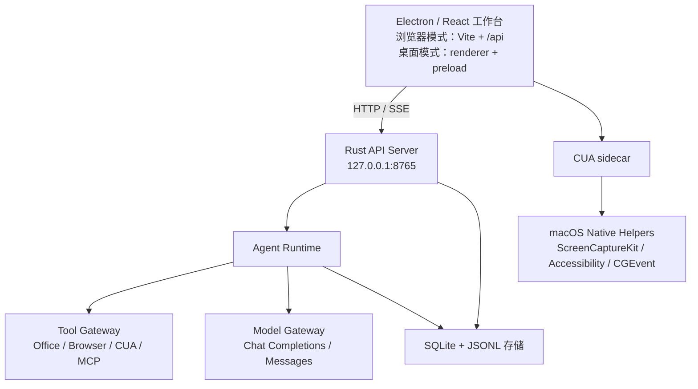

# Yukii Agent Harness

本地优先的桌面 Agent 工作台：Electron + Rust + Office 文件 + macOS Computer Use。

Yukii 把“文件处理、浏览器调研、桌面应用操作、可回放的 Agent 执行”放进同一个本地工作台。它面向单用户、本机数据不出本机的办公场景，不是云端 Agent 平台。

## 能力

- **Office 文件**：DOCX / XLSX / PPTX / PDF 的读取、生成、编辑与下载。
- **本地文件**：工作区读取、写入、编辑、目录浏览。
- **浏览器**：基于 CDP 的打开、读取、点击、输入与截图。
- **macOS Computer Use**：屏幕观察、AX 元素树、点击/输入/滚动、实时预览与审批。
- **知识库**：文档导入、BM25 + 向量混合检索、引用编号、后台索引。
- **长期记忆**：显式保存和检索用户记忆。
- **子 Agent**：独立子 Session、并行执行、消息投递、步骤边界 steer、中断与完成通知。
- **工具与扩展**：MCP、插件市场、SKILL、自定义工具。
- **可审计执行**：Session 事件、工具调用、用量、轨迹和可回放历史。

## 架构



关键设计：

- **JSONL 是 Session 历史事实源**，SQLite 负责索引、队列、幂等和搜索。
- **工具执行受白名单和参数校验约束**；CUA 首次使用需要系统授权和应用级审批。
- **网页端不开放本机执行**；本机能力只通过受信桌面链路进入。

更完整的分层说明见 [架构介绍](docs/architecture.md)。

## 环境要求

- macOS（当前 Computer Use 只在 macOS 上完整验证）
- Node.js 22+
- pnpm 11+
- Rust 2024 edition 工具链
- 本机 C 编译器（SQLite 构建）
- Docker（仅使用 bash/python 沙箱工具时需要）

## 快速开始

```bash
./tooling/start-local.sh
```

脚本会检查环境、安装依赖、构建并启动 API、Vite 和 Electron。退出 Electron 或按 Ctrl+C 会停止服务。

只检查环境：

```bash
./tooling/start-local.sh --check
```

手动启动：

```bash
pnpm install
./tooling/cargo.sh run -p yukii-api-server
# 另一个终端
pnpm dev
```

打开 `http://127.0.0.1:5173`。

## 配置

复制 `.env.example` 为 `.env`，至少配置：

```env
YUKII_API_FORMAT=openai
YUKII_API_BASE_URL=https://api.example.com/v1
YUKII_API_KEY=
YUKII_MODEL=
```

规则：

- `YUKII_API_BASE_URL` 填完整的版本前缀；建议显式配置实际使用的模型服务地址。
- 模型未配置时任务只保存为 queued，不会伪造执行。
- 使用 Computer Use 时需要额外声明模型支持视觉输入，并在 macOS 系统设置中授予屏幕录制和辅助功能权限。

详细配置和部署见 [部署与使用](docs/deployment.md)。

## 使用

1. 启动后在工作台创建任务。
2. 新任务可选“对话”或“工作”：工作模式首次发送会要求选择项目目录或使用默认目录；对话模式直接使用默认会话目录。
3. 输入目标；文件会写入当前会话工作区，也可以在右侧绑定项目目录或上传附件。
4. 文档任务会直接生成可下载文件；浏览器任务通过 CDP 操作；桌面任务需要先在侧栏选择并授权应用。
5. 在“轨迹”中查看每轮、每步、工具调用、耗时和用量。
6. 输入 `/` 选择命令：`/goal` 设定长期目标，`/plan` 进入计划模式。目标与执行计划会固定在输入框上方，全部完成后自动隐藏。

默认只监听 `127.0.0.1`。不要把它直接暴露到公网，也不要用于多租户部署；当前没有身份认证和租户隔离。

## 文档

- [部署与使用](docs/deployment.md)
- [架构介绍](docs/architecture.md)

## 状态

当前版本适合受监督的个人办公使用：

- 支持本地 Office 文件、浏览器和 macOS 桌面应用；
- 支持知识库、记忆、子 Agent、定时任务和 MCP；
- Windows/Linux 的 Computer Use、企业多租户、账号与云同步尚未实现。

生成的文件和桌面操作结果请人工验收后再用于重要场景。

## 许可证

[MIT](LICENSE)
