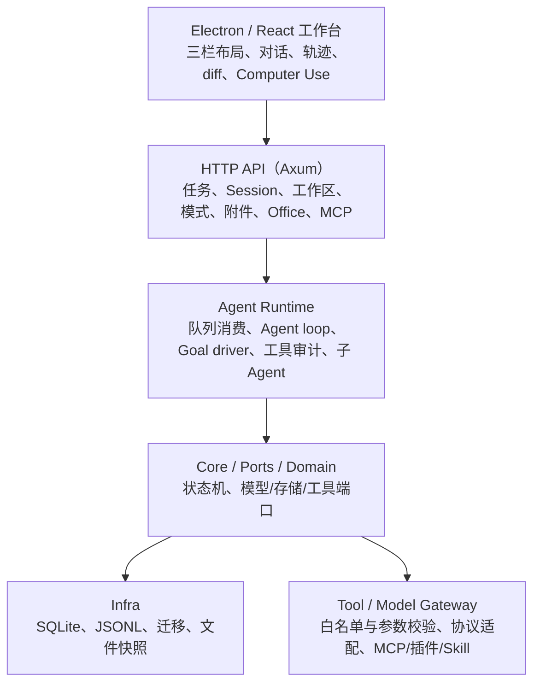
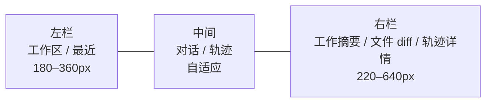
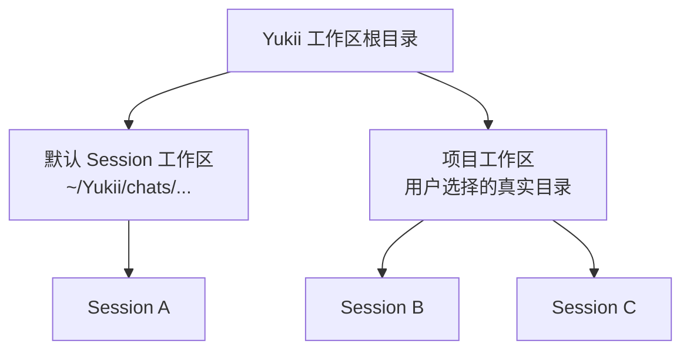
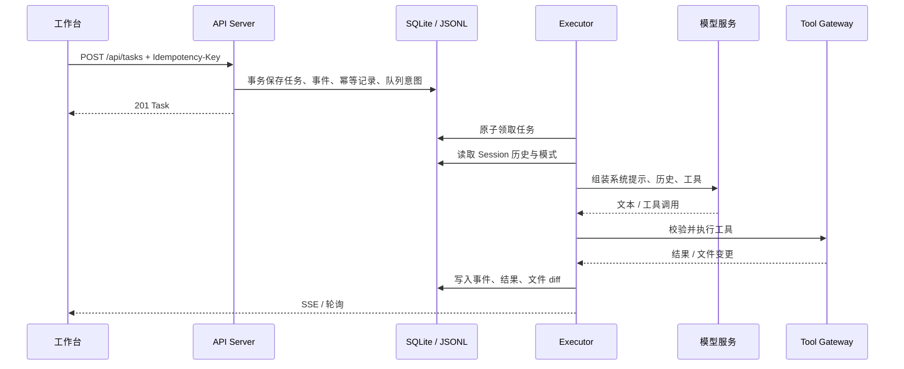
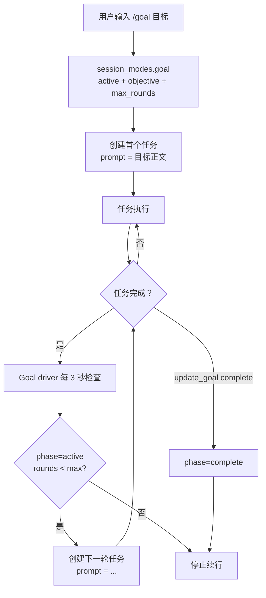
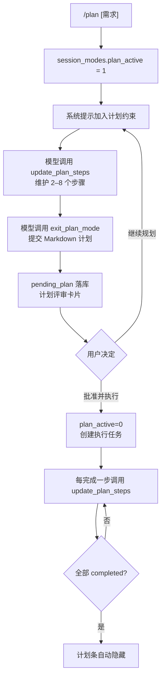
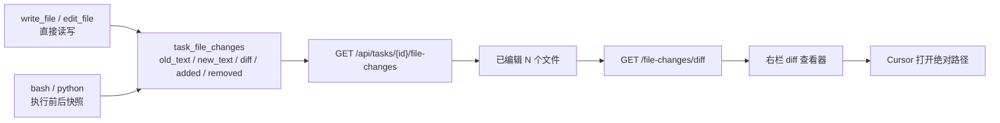

# 架构介绍

Yukii 是一个本地优先的桌面 Agent 工作台。本文介绍当前实现的分层、三栏工作台、Session/工作区模型、Goal/Plan 模式和文件变更链路。

## 1. 分层



依赖方向是单向的：

```text
api-server → runtime → core → ports
infra / model-gateway / tool-gateway → ports
```

`core` 不直接依赖 SQLite、HTTP 或具体模型供应商。

## 2. 工作台 UI

工作台固定为三栏：



- 左栏和右栏的竖向边界可以拖拽，宽度保存在浏览器本地。
- 左栏按工作区路径分组项目会话；同一项目下的多个 Session 共享一个工作区标题。
- 工作区行 hover 显示 `+`（新建对话）和 `...`（打开文件夹、复制路径、新建对话）。
- Session 行 hover 只显示 `...`；项目内会话不再重复提供“绑定项目”操作。
- 右栏是单一 rail：工作摘要、文件 diff、轨迹详情互斥展示。
- 文件 diff 和轨迹详情使用右栏宽度，不覆盖中间栏。
- 输入框左侧 `+` 菜单包含“命令 / 文件 / 知识库”。

## 3. 进程与边界

```text
Electron renderer
  └─ 窄 preload IPC
      ├─ Electron main
      ├─ CUA sidecar（Rust）
      └─ 桌面 Executor / 原生 helper

Rust API Server（127.0.0.1）
  ├─ HTTP API
  ├─ Agent Runtime
  └─ Goal driver

Docker
  └─ bash / python 工具隔离
```

网页模式只通过 HTTP 访问工作台，不暴露本机执行能力。Electron 额外提供：

- 打开工作区文件夹；
- 在 Cursor 中打开文件；
- 选择项目目录；
- Computer Use 侧栏。

## 4. Session 与工作区

每个 Session 都有且只有一个当前工作区：

```text
session_workspaces
  ├─ session_id
  ├─ path
  ├─ name
  ├─ kind = session | project
  └─ updated_at
```

默认工作区：

```text
~/Yukii/chats/<YYYY-MM-DD>/<session-id>
```

项目工作区：

- 用户在“工作”模式选择真实目录，或从 Session 的 `...` 绑定；
- 同一个项目路径可以挂多个 Session；
- UI 按 `path` 聚合项目分组；
- 在工作区行点 `+` 会创建一个待提交的新对话，第一条消息发送时绑定到同一路径。



工作区约束：

- `write_file` / `edit_file` 只接受相对路径；
- 路径不能跳出工作区；
- bash/python 在 Docker 中把工作区挂到 `/workspace`；
- API 在创建任务、读取模式、读取 diff 时校验 Session 与工作区。

## 5. 一次任务的执行



关键点：

- 创建任务和队列意图在同一事务提交；
- Worker 原子领取任务；
- 工具调用先经目录、Schema、目标路由和权限校验；
- 任务终态、事件、工具回执持久化；
- 崩溃恢复不承诺外部副作用 exactly-once。

## 6. Goal 模式

`/goal <目标>` 建立长期目标。命令本身不进入模型 prompt；模型看到的是目标正文和后续 Goal Round 提示。



- 默认最多 6 轮，可在创建时配置到 20；
- 模型工具：`get_goal`、`create_goal`、`update_goal`；
- 目标条固定在输入框上方，支持暂停、恢复、编辑、清除；
- 目标完成后目标条消失；
- 同一 Session 的 Goal Round 复用工作区和历史。

## 7. Plan 模式

Plan 模式把“探索/设计”和“执行”分开：



- `/plan` 激活模式；`/plan off` 或计划条“退出计划”关闭；
- `/plan <需求>` 只把需求正文作为普通用户消息，不发送 `/plan` 文本；
- 计划评审不再使用模态框，而是消息流里的临时卡片；
- 计划步骤存于 `session_modes.plan_steps`；
- 计划条固定在输入框上方，全部完成后隐藏；
- 模型工具：`enter_plan_mode`、`update_plan_steps`、`exit_plan_mode`。

## 8. 文件变更与 diff

文件变更不依赖工作区是否初始化 git：



- 同一任务内多次修改同一文件时，以第一次的旧内容为基线合并；
- 只记录可读取的 UTF-8 文本文件，单文件上限 2 MiB；
- bash/python 通过执行前后工作区快照发现新增和修改；
- 删除文件当前不进入“已编辑文件”卡片；
- 右栏 diff 显示行号、增删行和 +/− 统计；
- Cursor 按钮通过 Electron IPC 打开，不经过 HTTP。

## 9. 斜杠命令与思考计时

输入框只暴露两个斜杠命令：

```text
/goal  设定目标，智能体持续执行
/plan  计划模式，先设计步骤再执行
```

- 选择 `/goal` 后输入框显示蓝色 `/目标` 标记；
- 选择 `/plan` 后显示 `/计划`；
- 发送给模型的是目标/需求正文，命令本身不进入模型消息；
- 用户消息气泡记录并展示命令标记；
- 暂停、恢复、编辑、清除等控制放在目标条/更多菜单，不占用命令面板；
- 活动任务在消息区显示 `LLM 思考中 · Ns`，流式输出时显示 `生成中 · Ns`；
- 计时从首个 `running/planning` 事件开始，不包含排队时间。

## 10. 存储与迁移

```text
.data/tasks.sqlite
  ├─ tasks / events / tool_calls
  ├─ task_attachments
  ├─ session_workspaces
  ├─ session_modes（goal、plan、pending_plan、plan_steps）
  ├─ task_file_changes（old/new text + 行级 diff）
  ├─ conversation_compactions
  ├─ 幂等记录、队列、搜索结果
  └─ 工具回执

.data/sessions/<session_id>/session.jsonl
  └─ 会话历史事实源

.data/sessions/<session_id>/images/
  └─ 图片缓存
```

迁移按版本顺序执行，旧程序拒绝打开更新格式的数据库。当前新增迁移覆盖：

```text
0027 session_workspaces.kind
0028 session_modes
0029 session_modes.pending_plan
0030 session_modes.plan_steps
0031 task_file_changes
```

## 11. 工具与权限

工具分几类：

```text
文件 / 工作区
bash / python
浏览器
Office
Computer Use
MCP / 插件 / Skill
Goal / Plan 控制
```

工具执行前会经过：

```text
工具目录 → 参数 Schema → 目标路由 → 权限/审批 → 执行 → 审计
```

高风险或本机动作不会静默执行。网页 API 拒绝 `local_computer` 目标；本机执行只由受信桌面宿主建立。

## 12. Computer Use

```text
Agent
  → CUA sidecar
  → 原生 helper
      ├─ 观察屏幕
      ├─ 读取元素树
      └─ 点击 / 输入 / 滚动
```

优先使用可访问性元素，坐标点击只作回退。首次使用目标应用需要授权。

## 13. 知识库与记忆

```text
文档导入 → 切片 → BM25
→ 可选向量索引
→ RRF 融合
→ 引用编号
→ 作为低可信上下文注入
```

长期记忆通过显式 `remember` / `recall` 保存和检索，不自动推断敏感信息。

## 14. 子 Agent

```text
父 Session
  ├─ subagent/catalog
  ├─ spawn child Session
  ├─ send_message → child inbox
  └─ interrupt → cancel 当前 turn
```

子 Agent 有独立 JSONL 和任务状态；父级删除时会级联清理子 Session。

## 15. 当前边界

- 单用户、本地回环服务，没有账号和租户隔离；
- macOS Computer Use 优先，Windows/Linux 尚未完整实现；
- 复杂 Office 模板仍需要人工复核；
- 文件变更卡片只覆盖文本文件，删除和二进制文件不展示；
- 生成结果和桌面操作不承诺绝对正确。
