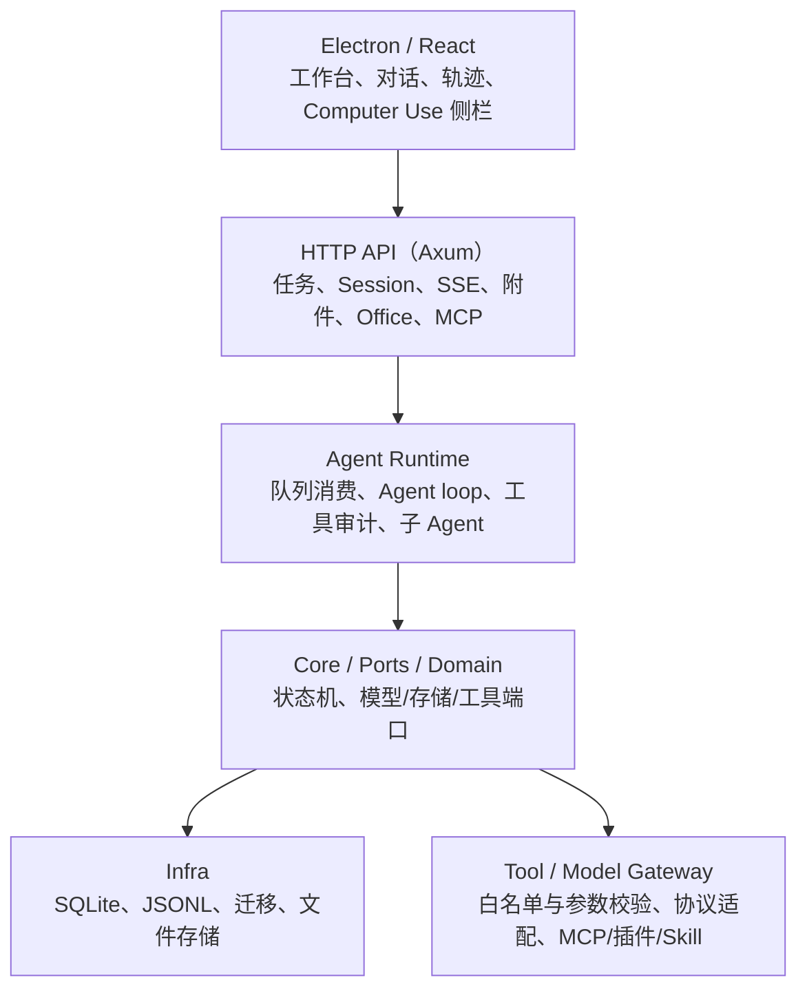

# 架构介绍

Yukii 是一个本地优先的桌面 Agent 工作台。本文介绍公开分层和数据流。

## 1. 分层



依赖方向是单向的：

```text
api-server → runtime → core → ports
infra / model-gateway / tool-gateway → ports
```

`core` 不直接依赖 SQLite、HTTP 或具体模型供应商。

## 2. 进程与边界

```text
Electron renderer
  └─ 窄 preload IPC
      ├─ Electron main
      └─ CUA sidecar（Rust）

Rust API Server（127.0.0.1）
  ├─ HTTP API
  └─ Agent Runtime

Native helpers
  ├─ ScreenCaptureKit
  ├─ Accessibility
  └─ CGEvent

Docker
  └─ bash / python 工具隔离
```

网页模式只通过 HTTP 访问工作台，不暴露本机执行能力。

## 3. 一次任务的执行

```text
1. 客户端提交任务 + Idempotency-Key
2. API 在事务中保存任务、事件、幂等记录和队列意图
3. Worker 原子领取任务
4. Agent loop 组装上下文、调用模型
5. 模型请求工具 → Tool Gateway 校验 → 执行
6. 工具结果、事件、用量写入存储
7. 模型生成最终回复
8. 任务进入终态，前端通过轮询/SSE 获取结果
```

## 4. Session 与存储

```text
.data/tasks.sqlite
  ├─ 任务、索引、队列
  ├─ 幂等记录
  ├─ 搜索结果
  └─ 工具回执

.data/sessions/<session_id>/session.jsonl
  └─ 会话历史事实源

.data/sessions/<session_id>/images/
  └─ 图片缓存
```

设计取舍：

- JSONL 便于导出、审计、回放和 fork；
- SQLite 提供事务、幂等、队列和搜索；
- 两者通过 outbox 解耦事务提交和文件追加；
- 崩溃后从持久队列和 outbox 恢复，不对外部副作用承诺 exactly-once。

## 5. 工具与权限

工具分几类：

```text
文件 / 工作区
bash / python
浏览器
Office
Computer Use
MCP / 插件 / Skill
```

工具执行前会经过：

```text
工具目录 → 参数 Schema → 目标路由 → 权限/审批 → 执行 → 审计
```

高风险或本机动作不会静默执行。

## 6. Computer Use

```text
Agent
  → CUA sidecar
  → 原生 helper
      ├─ 观察屏幕
      ├─ 读取元素树
      └─ 点击 / 输入 / 滚动
```

优先使用可访问性元素，坐标点击只作回退。首次使用目标应用需要授权。

## 7. 知识库与记忆

知识库：

```text
文档导入 → 切片 → BM25
→ 可选向量索引
→ RRF 融合
→ 引用编号
→ 作为低可信上下文注入
```

长期记忆通过显式 `remember` / `recall` 保存和检索，不自动推断敏感信息。

## 8. 子 Agent

```text
父 Session
  ├─ subagent/catalog
  ├─ spawn child Session
  ├─ send_message → child inbox
  └─ interrupt → cancel 当前 turn
```

子 Agent 有独立 JSONL 和任务状态；父级删除时会级联清理子 Session。

## 9. 当前边界

- 单用户、本地回环服务，没有账号和租户隔离；
- macOS Computer Use 优先，Windows/Linux 尚未完整实现；
- 复杂 Office 模板仍需要人工复核；
- 生成结果和桌面操作不承诺绝对正确。
